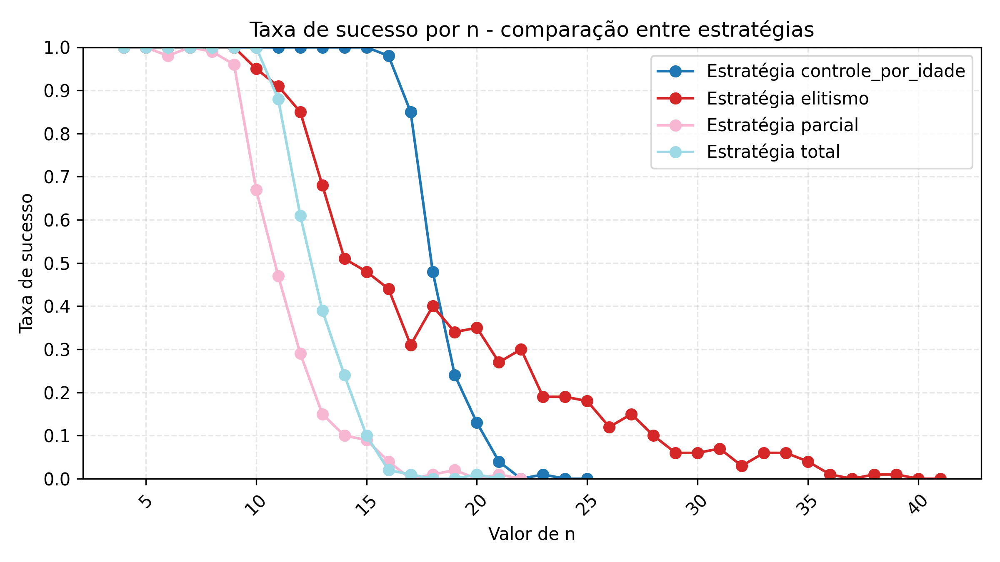

# Algoritmos genéticos aplicados ao problema das N-rainhas

Artigo de TCC sobre o impacto de quatro estratégias de controle populacional na busca por soluções do problema das N-rainhas. A comparação mantém os operadores genéticos constantes e utiliza o mesmo orçamento de avaliações da função de aptidão.

**Autores:** Vinícius Rubin e Igor Yepes.

**Instituição:** Instituto Federal Farroupilha — Campus Frederico Westphalen (IFFAR-FW).

[Ler o artigo em PDF](TCC-Viniciusrubin.pdf) · [Apresentação para o portfólio](docs/portfolio.md) · [Dados para o site pessoal](docs/project.json)

## O problema

Como posicionar N rainhas em um tabuleiro N × N sem que elas se ataquem? O trabalho usa esse problema clássico para investigar como a política de renovação da população afeta a qualidade das soluções, a convergência e o custo da busca em algoritmos genéticos.

## Estratégias comparadas

| Estratégia | Política avaliada |
| --- | --- |
| Substituição total | Renovação de toda a população a cada geração. |
| Substituição parcial | Substituição de 25% da população. |
| Elitismo | Preservação dos 10% melhores indivíduos. |
| Controle por idade | Renovação por tempo de vida, inspirada no GAVaPS, com população variável. |

O protocolo descrito no artigo utiliza população inicial de 100 indivíduos, seleção por torneio binário, cruzamento OX, mutação por troca com taxa de 10% e 100 execuções independentes por configuração. Cada execução termina ao encontrar uma solução válida ou atingir `2 × P × N` avaliações, sendo `P` o tamanho da população inicial.

## Resultados apresentados no artigo

O estudo relata que o controle por idade oferece um bom equilíbrio entre qualidade e eficiência em instâncias intermediárias. O elitismo apresenta melhores resultados em instâncias maiores, com maior custo de tempo. As estratégias de substituição total e parcial perdem desempenho conforme aumenta o tamanho do problema.



Os resultados se referem às condições experimentais do artigo. Entre as limitações discutidas estão o uso de um único problema, parâmetros fixos e a ausência de análises estatísticas formais aprofundadas.

## Conteúdo do repositório

Este repositório reúne o texto LaTeX, a bibliografia, os gráficos e uma versão já compilada do artigo. **O código Python dos experimentos, as sementes e os dados brutos não estão incluídos.** Compilar o documento permite reconstruir o artigo; reproduzir os experimentos depende desses materiais adicionais.

```text
ArtigoTCC/
├── README.md
├── .latexmkrc                   # Compilação com saída em build/
├── TCC-ViniciusRubin.tex         # Documento principal
├── TCC-ViniciusRubin.bib         # Bibliografia BibTeX
├── TCC-Viniciusrubin.pdf         # PDF existente, preservado no caminho original
├── sbc-template.sty             # Formatação SBC utilizada pelo artigo
├── sbc.bst                      # Estilo bibliográfico SBC
├── sections/                    # Seções do artigo e materiais do projeto de TCC
├── pic/                         # Gráficos do estudo
├── docs/
│   ├── portfolio.md             # Texto para apresentar o projeto
│   └── project.json             # Metadados reutilizáveis no site
├── referencias/                 # PDFs bibliográficos de apoio
└── build/                       # Saída local, ignorada pelo Git
```

As tecnologias descritas para a ferramenta experimental são Python, NumPy, Numba e Matplotlib. Os arquivos editáveis disponíveis aqui utilizam LaTeX e BibTeX.

Os caminhos dos materiais originais foram mantidos. As seções `cronograma.tex`, `justificativa.tex` e `objetivos.tex` estão preservadas em `sections/`, mas não são incluídas no documento principal atual. As imagens `fig1.jpg`, `fig2.jpg` e `table.jpg` e o estilo `caption2.sty` também não são utilizados por ele.

## Compilar o artigo

É necessária uma distribuição LaTeX com `pdflatex`, `bibtex` e `latexmk`, além dos pacotes usados pelo documento, incluindo o suporte ao português, TikZ, chessboard, algorithm e algpseudocode. Os estilos SBC utilizados estão na raiz. No Windows, o `latexmk` também precisa de um interpretador Perl disponível.

Na raiz do repositório, execute:

```sh
latexmk TCC-ViniciusRubin.tex
```

A configuração em `.latexmkrc` seleciona PDFLaTeX, gerencia as passagens da bibliografia e grava o resultado em `build/TCC-ViniciusRubin.pdf`. Para limpar apenas os arquivos auxiliares:

```sh
latexmk -c TCC-ViniciusRubin.tex
```

Para usar um editor LaTeX online, envie os fontes, mantenha as pastas `sections/` e `pic/` e selecione `TCC-ViniciusRubin.tex` como documento principal, com PDFLaTeX. Os PDFs de `referencias/` não são necessários para compilar.

O PDF em `TCC-Viniciusrubin.pdf` é a versão que já estava no repositório. O nome desse arquivo contém `rubin` com `r` minúsculo; preserve essa grafia nos links, pois o GitHub diferencia maiúsculas de minúsculas. Após uma revisão dos fontes, confira o PDF gerado antes de substituir essa versão de leitura.

A configuração de compilação foi preparada, mas uma nova compilação do PDF não foi validada durante esta organização, pois o ambiente utilizado não possui uma distribuição LaTeX instalada.

## Usar no site pessoal

O arquivo [docs/portfolio.md](docs/portfolio.md) contém uma descrição curta para um cartão de projeto e uma apresentação mais completa. [docs/project.json](docs/project.json) reúne título, resumo, autores, temas, links e caminhos dos materiais para facilitar a integração futura.

Os caminhos em `project.json` são relativos à raiz deste repositório. Para hospedar o PDF e o gráfico no site, copie os arquivos indicados e adapte os caminhos ao seu projeto. O link do artigo abre o PDF no GitHub, na branch `main`; ele não é um endereço de arquivo para incorporar diretamente em um visualizador. Os arquivos de documentação estarão disponíveis no GitHub depois que as alterações forem publicadas.

## Créditos

A autoria do artigo está registrada no documento. Os estilos SBC e os materiais bibliográficos de terceiros preservam seus respectivos créditos; os PDFs de referência não fazem parte dos materiais sugeridos para o portfólio.
